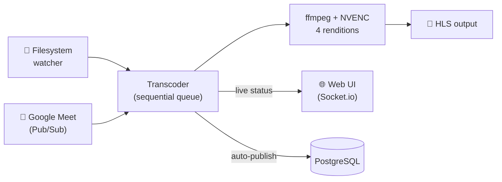

# auto-convert-to-hls


Automatically converts MP4 recordings to multi-rendition HLS for video-on-demand. Supports two ingestion sources: a watched filesystem directory and Google Meet recordings via Google Pub/Sub.



> **Architecture & design:** see [`docs/ARCHITECTURE.md`](docs/ARCHITECTURE.md) for system design, ingestion/transcoding workflows, data-flow and data-model diagrams.

## Requirements

- Node.js ≥ 24 with Yarn
- PostgreSQL database
- NVIDIA GPU with cuvid support (used for hardware-accelerated transcoding)
- ffmpeg built with `h264_cuvid` support

## Setup

```bash
yarn
yarn backend prisma generate
yarn backend prisma migrate dev
```

Copy and configure environment variables (see [Environment Variables](#environment-variables) below).

## Testing

```bash
yarn test
```

No GPU, database, or ffmpeg required — all external dependencies are mocked.

## Running

**Development:**
```bash
yarn dev
```

**Production:**
```bash
yarn start
```

The web UI is served on port `3000`. The backend API and Socket.io run on `PORT` (default `4000`).

## Docker

```bash
docker compose up
```

Mount your source and destination directories as volumes. The container uses the `nvidia` runtime — ensure the NVIDIA Container Toolkit is installed on the host.

Pre-built images are published to `ghcr.io/bossoq/auto-convert-to-hls` on every push to `main`, tagged with both a short commit SHA and `latest`.

## How It Works

### Ingestion

**Filesystem watcher:** Chokidar watches the top level of the `SOURCE` directory for new `.mp4` files. Files in subdirectories (`google/`, `converted/`) and hidden files are ignored. A file is only picked up once its size has been stable for 10 seconds, plus a 10-second debounce, so it is fully written before transcoding begins. Tip: copy under a `.`-prefixed name and rename when done.

**Google Meet (Pub/Sub):** Listens for `google.workspace.meet.recording.v2.fileGenerated` events. Downloads the recording from Google Drive into `SOURCE/google/`, then enqueues it. On startup, any previously unprocessed records in the database are replayed automatically.

### Transcoding

Jobs are processed one at a time. For each MP4:

1. Output directory created under `DEST`
2. Thumbnail captured at 00:00:10 as `cover.jpg`
3. Transcoded to four renditions using NVIDIA cuvid (`h264_cuvid`):

   | Resolution | Video bitrate | Audio bitrate |
   |---|---|---|
   | 360p | 800k | 96k |
   | 480p | 1400k | 128k |
   | 720p | 2800k | 128k |
   | 1080p | 5000k | 192k |

4. HLS master playlist (`index.m3u8`) written — only after ffmpeg exits cleanly, so a failed job never leaves a playable-looking folder. A failed job is logged and skipped: the source stays in place and nothing is published.
5. Source file moved to a `converted/` subdirectory

For Google Meet recordings with `autoPublish` enabled, the job also marks the `videoProcess` record as processed and creates a `videoTable` entry in the database.

### API

| Endpoint | Description |
|---|---|
| `GET /status` | Current job name, frame progress, FPS, speed |
| `GET /queue` | Pending queue length and job list |

Socket.io emits `status` and `queue` events on every state change, used by the web UI for live updates. The client connects using WebSocket transport only (no XHR long-polling), which avoids compatibility issues with reverse proxies.

## Environment Variables

| Variable | Default | Description |
|---|---|---|
| `SOURCE` | `/source/` | Directory to watch for incoming MP4 files |
| `DEST` | `/dest/` | Output directory for HLS segments and playlists |
| `PORT` | `4000` | Backend API / Socket.io port |
| `CORSHOST` | `https://vodstatus.picturo.us` | Allowed CORS origin(s) for the backend — accepts a single origin or a comma-separated list |
| `DATABASE_URL` | — | Prisma primary PostgreSQL connection string |
| `DIRECT_URL` | — | Prisma direct PostgreSQL connection string |
| `PROJECT_ID` | — | Google Cloud project ID |
| `TOPIC_NAME` | — | Pub/Sub topic name |
| `SUBSCRIPTION_NAME` | — | Pub/Sub subscription name |
| `CLIENT_EMAIL` | — | Service account email |
| `PRIVATE_KEY` | — | Service account private key |
| `SUBJECT` | — | Domain-wide delegation subject (impersonated user) |
| `VOD_BASE_URL` | `https://vod.supapanya.com` | Base URL prepended to job name for auto-published VOD entries |
| `PUBLIC_SOCKET_URL` | _(same origin)_ | Socket.io server URL for the web UI (set in `web/.env.public`) |

## License

MIT
